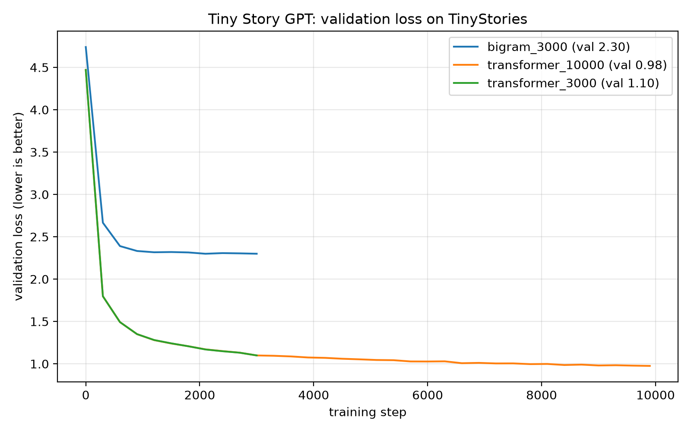
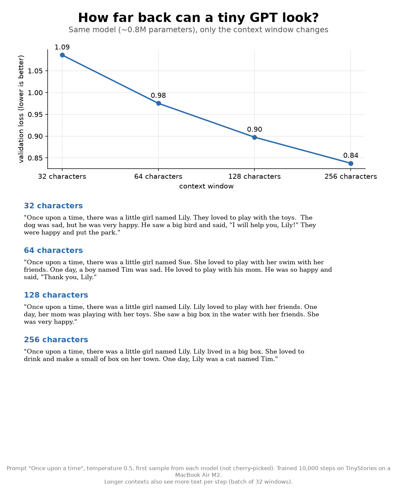
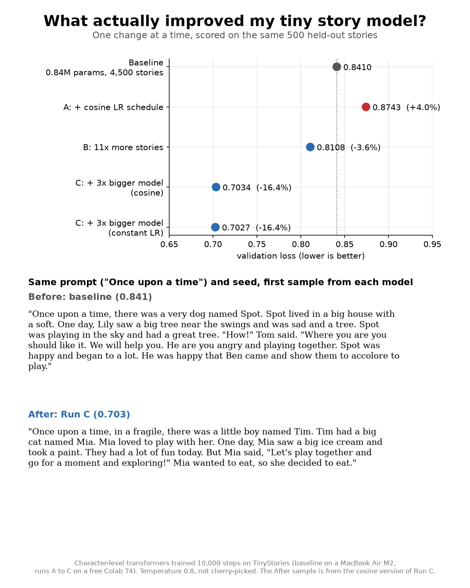

# tiny-story-gpt

A small character-level GPT trained from scratch on children's stories, on a MacBook Air (M2, 8 GB)
and a free Colab T4 GPU. It compares a bigram baseline with a transformer, tests what actually
improves it, and reads its stories aloud with a mood-aware narrator.

## Results

Trained on 4,500 TinyStories, validated on 500 held-out stories (character-level, 70-character vocabulary).

| model | parameters | steps | val loss | training time (M2 GPU) |
|---|---|---|---|---|
| bigram | 4,900 | 3,000 | 2.300 | 5 s |
| transformer | 817,990 | 3,000 | 1.099 | 74 s |
| transformer | 817,990 | 10,000 | 0.975 | 232 s |



Samples, prompted with "Once upon a time" or "One day, Lily".

Bigram (temperature 0.7):

```
Once upon a timer the bir ilo ath they hed t im an wik be ut man ha...
```

Transformer (10,000 steps, temperature 0.5, best of 15 samples; most samples drift off within two sentences):

```
Once upon a time, there was a little boy named Tim. Tim loved to play with his friends.

One day, Lily and the bird were so happy and sad. They were sorry and Anna was very sad.
They all lived happily ever after.
```

The transformer learned spelling, names, dialogue and sentence rhythm, but not meaning yet.
At 0.8M parameters with a 64-character context, it is too small to keep a story coherent.

GPU usage during the 10,000-step run is logged in `results/gpu_usage_10000.csv`
(about 92% utilization while training, about 120 MB allocated by PyTorch).

## Context window experiment

Same transformer, retrained for 10,000 steps with different context windows (how many characters it can look back at).

| context | parameters | val loss | training time (M2 GPU) |
|---|---|---|---|
| 32 characters | 813,894 | 1.086 | 266 s |
| 64 characters | 817,990 | 0.975 | 232 s |
| 128 characters | 826,182 | 0.897 | 466 s |
| 256 characters | 842,566 | 0.838 | 1,656 s |



Loss improves with every increase in context, but the samples (first sample from each model, same prompt and seed)
don't get clearly more coherent: the 256-character model still writes "One day, Lily was a cat named Tim."
Longer contexts also see more text per step, so part of the loss gain is extra training.
GPU logs for these runs are in `results/gpu_usage_ctx*.csv`.

## What improved the model (Colab experiments)

Starting from the 256-character model, each run changes one thing. Every model is scored with
`src/evaluate.py` on the full validation set (the same 500 held-out stories, every character once),
so the numbers are directly comparable. The baseline's earlier 0.838 was an estimate from random batches.

| run | change | data | parameters | LR schedule | full val loss | training time (T4) |
|---|---|---|---|---|---|---|
| baseline | (ctx256 model above) | 4,500 stories | 842,566 | constant | 0.8410 | 1,656 s on the M2 |
| A | cosine learning rate schedule | 4,500 stories | 842,566 | cosine | 0.8743 | 553 s |
| B | 11x more data | 49,500 stories | 846,421 | constant | 0.8108 | 556 s |
| C | 3x bigger model (192-dim, 6 heads, 6 layers) | 49,500 stories | 2,747,989 | cosine | 0.7034 | 1,433 s |
| C, re-run | same as C without the schedule | 49,500 stories | 2,747,989 | constant | 0.7027 | 1,434 s |



- **The cosine schedule hurt the small model** (0.841 to 0.874). Its loss was still falling at step 10,000,
  so lowering the learning rate meant it learned less in the same number of steps.
- **On the big model it made no difference** (0.7034 vs 0.7027), so all of the gain came from data and size:
  more data took 3.6% off the loss, and the bigger model a further 13.3% (16.4% in total).
- With 11x more data, train and val loss stay level (no overfitting): the small model had run out of
  capacity, not data, which is why the bigger model helped most.
- The larger training set adds 15 new characters (85 in total), so B and C have slightly bigger
  embedding tables. Validation is still scored on the same text.

Same prompt and seed (temperature 0.8), first sample from each model:

```
Baseline (0.841): Once upon a time, there was a very dog named Spot. Spot lived in a big house with a soft.
One day, Lily saw a big tree near the swings and was sad and a tree. [...] He was happy that Ben came and
show them to accolore to play.

Run C (0.703): Once upon a time, in a fragile, there was a little boy named Tim. Tim had a big cat named Mia.
Mia loved to play with her. One day, Mia saw a big ice cream and took a paint. They had a lot of fun today.
But Mia said, "Let's play together and go for a moment and exploring!" [...] "Do you want to eat the ice
cream cream?" The end.
```

The bigger model stops inventing words and picks up the shape of a TinyStories plot ("But then, something
unexpected happened", "The end"), but it still doesn't make sense: it learned how stories sound, not what
happens in them. The samples come from the cosine version of Run C.

The runs are in `colab/train_runs.ipynb` (open it in Colab with a T4 GPU runtime).
Results and logs: `results/run*.json`, `results/train_run*.log`.

## Narration

`src/speak.py` generates a story and reads it aloud with [Piper](https://github.com/rhasspy/piper)
(a small local neural voice, `en_US-lessac-medium`) and macOS `say`. The narrated version:

1. trims the story to its last full sentence (generation stops mid-word) and splits it into sentences,
2. gives each sentence a mood from its words (sad, scary, happy, ...) or a final "!",
3. reads each sentence with that mood's speed, volume, expression and rhythm, then a pause.

| mood | speed (length_scale) | volume | expression (noise_scale) | rhythm (noise_w_scale) | pause |
|---|---|---|---|---|---|
| calm | 1.0 | 0.8 | 0.667 | 0.8 | 0.4 s |
| excited | 0.95 | 1.0 | 1.2 | 1.2 | 0.45 s |
| sad | 1.25 | 0.55 | 0.4 | 0.5 | 0.7 s |
| tense | 1.15 | 0.65 | 0.5 | 0.6 | 0.6 s |

Piper normalizes each sentence to full loudness before applying `volume`, so 1.0 is the ceiling and calm
sits at 0.8 to leave room for excited. The settings were tuned by ear. The voice doesn't understand emotion:
the rules decide how each line is read.

## Model

- Bigram: a 70 x 70 lookup table predicting the next character from the current one.
- Transformer: 4 blocks of 4-head causal self-attention and a feed-forward layer, 128-dim embeddings,
  64-character context, dropout 0.1, AdamW at 1e-3, batch size 32. Run C uses 6 blocks of 6 heads
  and 192-dim embeddings.

## Project layout

```
src/prepare_data.py     fixed 4,500/500 split; --extra-stories builds a larger training file
src/load_data.py        character vocabulary and random batches
src/model.py            BigramModel and TransformerModel
src/train.py            training loop; saves results/<run>.json and checkpoints/<run>.pt
src/evaluate.py         full validation loss for any checkpoint (the scoreboard)
src/device.py           picks CUDA, Apple GPU (MPS) or CPU
src/compare.py          comparison table and results/loss_comparison.png
src/generate.py         load a checkpoint and write samples at a given temperature
src/make_card.py        context-window results card (results/context_card.png)
src/make_runs_card.py   Colab experiments results card (results/runs_card.png)
src/speak.py            narrate a generated story (Piper and macOS say)
src/build_datastore.py  kNN-LM datastore from the training set (experiment in progress)
colab/train_runs.ipynb  the Colab training runs
results/                per-run results (JSON), logs, charts, GPU logs, sample audio (results/voice)
```

## Run it

```bash
python3.12 -m venv .venv
source .venv/bin/activate
pip install -r requirements.txt
```

The stories are the start of `TinyStoriesV2-GPT4-train.txt` from
[TinyStories](https://huggingface.co/datasets/roneneldan/TinyStories). Download the first ~48 MB
(about 58,000 stories) and build the splits. `prepare_data.py` also maps typographic quotes, dashes
and ellipses to ASCII, which reproduces the original 70-character data exactly.

```bash
curl -sL https://huggingface.co/datasets/roneneldan/TinyStories/resolve/main/TinyStoriesV2-GPT4-train.txt | head -c 48000000 > data/tinystories_raw.txt
python src/prepare_data.py --source data/tinystories_raw.txt --extra-stories 45000
```

This writes `data/train.txt` (4,500 stories), `data/valid.txt` (500) and `data/train_49500.txt`. Then:

```bash
python src/train.py --model bigram --steps 3000 --name bigram_3000
python src/train.py --steps 10000 --name transformer_10000
python src/compare.py
python src/generate.py transformer_10000 0.5

# context window experiment
python src/train.py --steps 10000 --ctx 128 --name transformer_10000_ctx128
python src/compare.py "transformer_10000*" context_comparison.png
python src/make_card.py

# what improved it (runs A, B, C), then score them on the full validation set
python src/train.py --steps 10000 --ctx 256 --lr-schedule cosine --name runA_cosine
python src/train.py --steps 10000 --ctx 256 --train-file data/train_49500.txt --name runB_data50k
python src/train.py --steps 10000 --ctx 256 --train-file data/train_49500.txt --n-embd 192 --n-head 6 --n-layer 6 --name runC_bigger_constant
python src/evaluate.py transformer_10000_ctx256 runA_cosine runB_data50k runC_bigger_constant

# narrate a story (needs pip install piper-tts and the voice files in voices/)
python src/speak.py runC_bigger piper
```

The Piper voice is two files from
[rhasspy/piper-voices](https://huggingface.co/rhasspy/piper-voices/tree/main/en/en_US/lessac/medium):
`en_US-lessac-medium.onnx` and `en_US-lessac-medium.onnx.json`, saved in `voices/` (not in the repo).

Lower temperature (e.g. 0.5) gives safer, more readable text; 1.0 samples the model's raw probabilities.

## Credits

- Data: [TinyStories](https://huggingface.co/datasets/roneneldan/TinyStories) by Ronen Eldan and Yuanzhi Li, licensed under CDLA-Sharing-1.0. The data is not included in this repo.
- Model structure follows Andrej Karpathy's [Let's build GPT](https://www.youtube.com/watch?v=kCc8FmEb1nY).
- Voice: [Piper](https://github.com/rhasspy/piper) with the `en_US-lessac-medium` voice.
