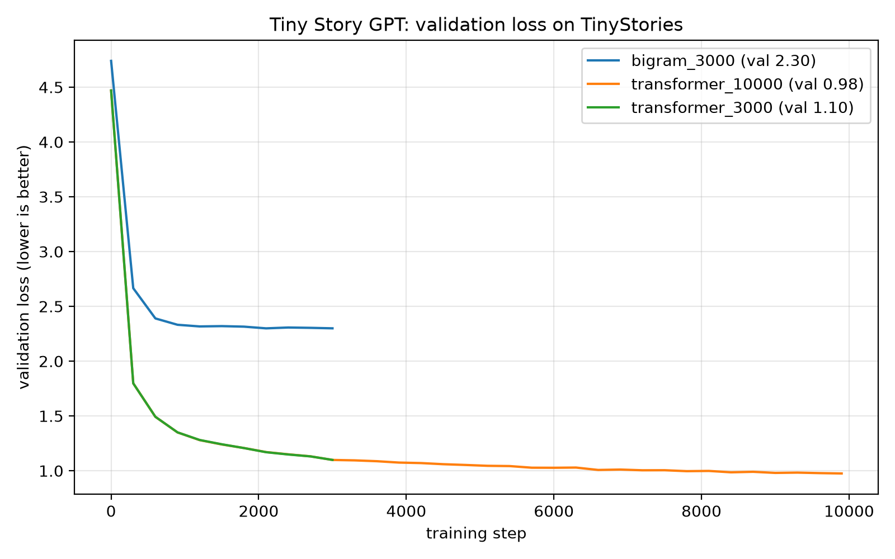
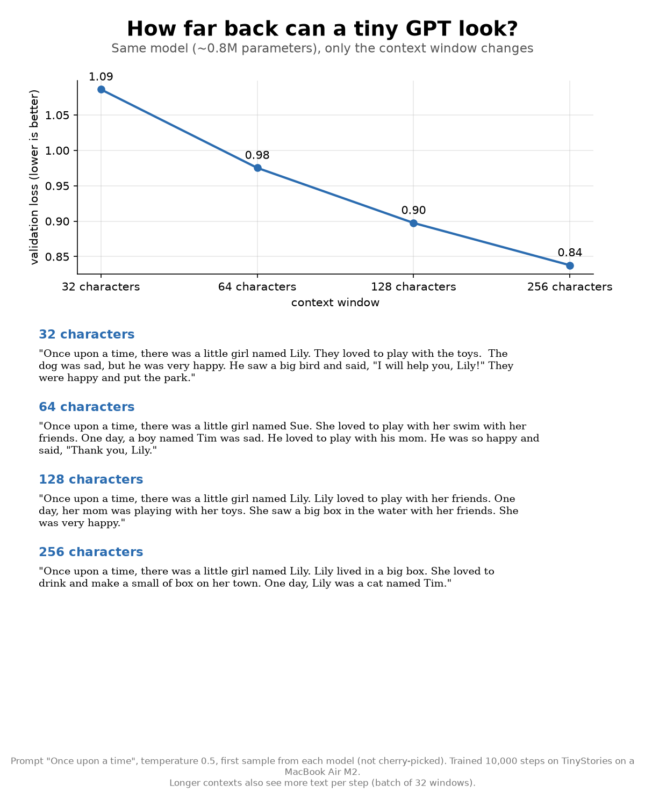

# tiny-story-gpt

A small character-level GPT trained from scratch on children's stories, on a MacBook Air (M2, 8 GB).
It compares a bigram baseline with a 4-layer transformer trained on the same data.

## Results

Trained on 4,500 TinyStories, validated on 500 held-out stories (character-level, 70-character vocabulary).

| model | parameters | steps | val loss | training time (M2 GPU) |
|---|---|---|---|---|
| bigram | 4,900 | 3,000 | 2.300 | 5 s |
| transformer | 817,990 | 3,000 | 1.099 | 74 s |
| transformer | 817,990 | 10,000 | 0.975 | 232 s |



Samples, prompted with "Once upon a time" or "One day, Lily".

Bigram (temperature 0.7):

```
Once upon a timer the bir ilo ath they hed t im an wik be ut man ha...
```

Transformer (10,000 steps, temperature 0.5, best of 15 samples; most samples drift off within two sentences):

```
Once upon a time, there was a little boy named Tim. Tim loved to play with his friends.

One day, Lily and the bird were so happy and sad. They were sorry and Anna was very sad.
They all lived happily ever after.
```

The transformer learned spelling, names, dialogue and sentence rhythm, but not meaning yet.
At 0.8M parameters with a 64-character context, it is too small to keep a story coherent.

GPU usage during the 10,000-step run is logged in `results/gpu_usage_10000.csv`
(about 92% utilization while training, about 120 MB allocated by PyTorch).

## Context window experiment

Same transformer, retrained for 10,000 steps with different context windows (how many characters it can look back at).

| context | parameters | val loss | training time (M2 GPU) |
|---|---|---|---|
| 32 characters | 813,894 | 1.086 | 266 s |
| 64 characters | 817,990 | 0.975 | 232 s |
| 128 characters | 826,182 | 0.897 | 466 s |
| 256 characters | 842,566 | 0.838 | 1,656 s |



Loss improves with every increase in context, but the samples (first sample from each model, same prompt and seed)
don't get clearly more coherent: the 256-character model still writes "One day, Lily was a cat named Tim."
Longer contexts also see more text per step, so part of the loss gain is extra training.
GPU logs for these runs are in `results/gpu_usage_ctx*.csv`.

## Model

- Bigram: a 70 x 70 lookup table predicting the next character from the current one.
- Transformer: 4 blocks of 4-head causal self-attention and a feed-forward layer, 128-dim embeddings,
  64-character context, dropout 0.1, AdamW at 1e-3, batch size 32.

## Project layout

```
src/prepare_data.py   split the stories 90/10 into data/train.txt and data/valid.txt
src/load_data.py      character vocabulary and random batches
src/model.py          BigramModel and TransformerModel
src/train.py          training loop; saves results/<run>.json and checkpoints/<run>.pt
src/compare.py        comparison table and results/loss_comparison.png
src/generate.py       load a checkpoint and write samples at a given temperature
src/make_card.py      context-window results card (results/context_card.png)
results/              per-run results (JSON), loss chart, GPU log
```

## Run it

```bash
python3.12 -m venv .venv
source .venv/bin/activate
pip install -r requirements.txt
```

Put the first 5,000 stories from [TinyStories](https://huggingface.co/datasets/roneneldan/TinyStories)
in `data/tinystories_5k.txt`, separated by `<|endoftext|>`, then:

```bash
python src/prepare_data.py
python src/train.py bigram 3000
python src/train.py transformer 10000
python src/compare.py
python src/generate.py transformer_10000 0.5

# context window experiment
python src/train.py transformer 10000 128
python src/compare.py "transformer_10000*" context_comparison.png
python src/make_card.py
```

Lower temperature (e.g. 0.5) gives safer, more readable text; 1.0 samples the model's raw probabilities.

## Credits

- Data: [TinyStories](https://huggingface.co/datasets/roneneldan/TinyStories) by Ronen Eldan and Yuanzhi Li, licensed under CDLA-Sharing-1.0. The data is not included in this repo.
- Model structure follows Andrej Karpathy's [Let's build GPT](https://www.youtube.com/watch?v=kCc8FmEb1nY).
